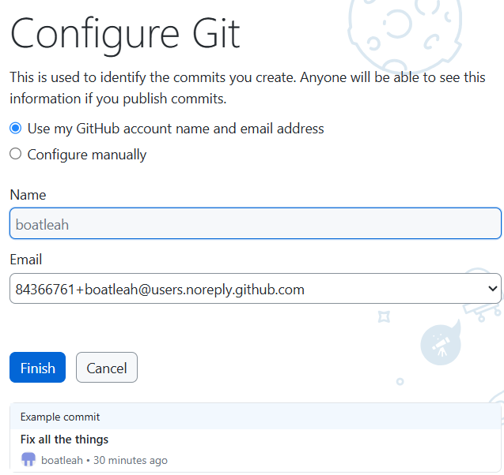
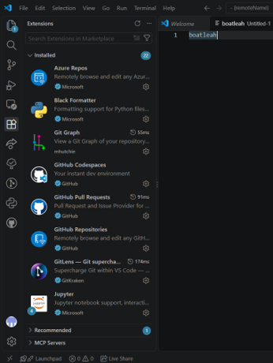
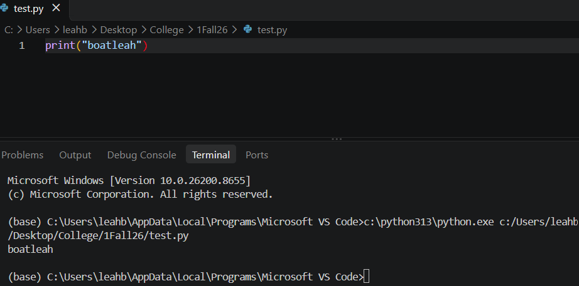
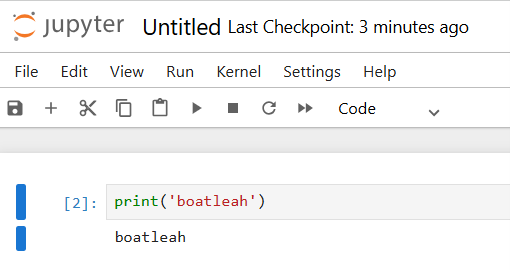
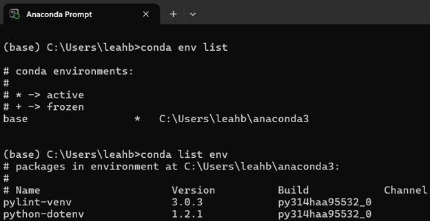
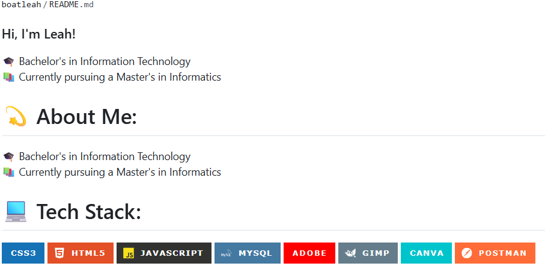

# INFO-762-Assignment-2
INFO 762 Module 1: Assignment 2 -- Python and Github Staging

# Setup Screenshots

## 1. GitHub Desktop

---

## 2. VS Code Configuration

---

## 3. VS Code with Python

---

## 4. Jupyter Notebook

---

## 5. Anaconda

---

## 6. Git Repository

